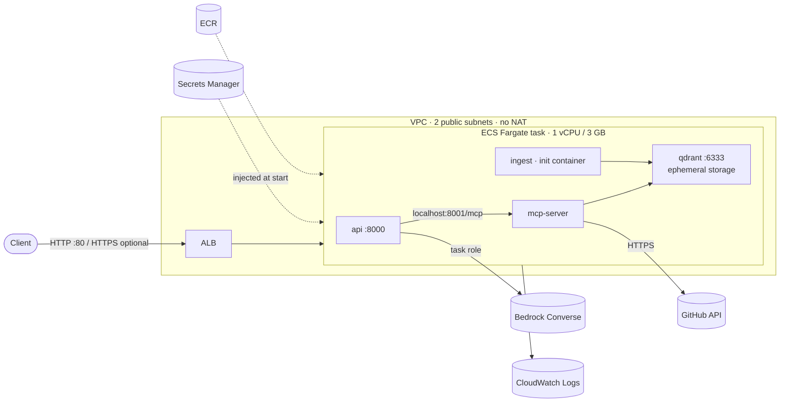

# 10 — Infrastructure (AWS ECS Fargate + Bedrock)

Status: `accepted` · Phase: 4 (applied only at the end, on request)

## Goals

- Terraform under `infra/` that deploys the API to **ECS Fargate** with least-privilege access to
  **Bedrock**, secrets in **Secrets Manager**, logs in **CloudWatch**.
- `terraform plan` is clean with no credentials beyond read access; `apply`/`destroy` are documented, with a
  cost estimate and a teardown checklist.
- Low idle cost: no NAT gateway, no RDS, a single task, and it can be scaled to zero.

## Non-goals

- High availability, autoscaling, a custom domain or WAF (documented as upgrades), and a multi-environment layout.

## Topology



- **One task, four containers.** `qdrant` is a sidecar on ephemeral task storage. The `ingest` init
  container (`dependsOn` qdrant HEALTHY, essential=false) loads `docs/` at startup. The corpus is small
  (seconds with fastembed), so we skip EFS. `api` waits for `ingest` to reach `SUCCESS`.
- **Checkpointer**: SQLite on ephemeral storage. **Trade-off (documented):** runs paused for approval are
  lost when the task is replaced (deploy or crash). The upgrade path is `CHECKPOINTER=postgres` plus RDS
  (`~$15+/mo`), which is a variable switch in a later iteration.
- Public subnets with `assign_public_ip=true` (so we don't pay for NAT); the task security group only allows
  ingress from the ALB SG on 8000. The MCP server and Qdrant are reachable only on localhost inside the task.
- HTTPS: if `acm_certificate_arn` is set, the ALB adds a 443 listener and HTTP redirects to it. Otherwise it serves
  HTTP only, and the API key (`X-API-Key`) is required (spec 01). The README states this clearly.

## Terraform layout

```
infra/
├── versions.tf        # terraform >= 1.9, hashicorp/aws ~> 6.x (version verified at implementation time)
├── variables.tf       # region, bedrock_model_ids, image_tag, github_repo, acm_certificate_arn, desired_count...
├── network.tf         # VPC, 2 public subnets, IGW, route tables, SGs
├── ecr.tf             # repositories: api (also used for mcp-server and ingest via different commands)
├── ecs.tf             # cluster, task definition, service, ALB, target group, listener(s)
├── iam.tf             # execution role, task role (Bedrock), GitHub OIDC role for CI evals
├── secrets.tf         # GITHUB_TOKEN, API_KEY (values set out-of-band, never in state via variables)
├── logs.tf            # log group, 14-day retention
├── outputs.tf         # alb_dns_name, ecr_repo_url, ci_role_arn
├── terraform.tfvars.example
└── README.md          # costs, apply/destroy, verification steps
```

State is local by default. An optional S3 backend (with native S3 locking) is documented, not required.

## IAM (least privilege)

- **Task role**: `bedrock:InvokeModel`, `bedrock:InvokeModelWithResponseStream`, `bedrock:Converse`,
  `bedrock:ConverseStream` on **only** the configured inference-profile ARNs and the foundation-model ARNs they
  route to (cross-region profiles need both). Nothing else.
- **Execution role**: ECR pull, CloudWatch Logs write, `secretsmanager:GetSecretValue` on the two secrets.
- **CI role (GitHub OIDC)**: trust limited to `repo:<owner>/agentic-docs-assistant:ref:refs/heads/main` and
  `pull_request` from the same repo; permissions are Bedrock invoke on the judge and agent profiles only.

## Cost estimate (us-east-1, monthly, idle demo; verify against current pricing in Phase 4)

| Item | Estimate |
|---|---|
| Fargate 1 vCPU / 3 GB, 24×7 | ~$39 |
| ALB (hours + minimal LCU) | ~$18 |
| Public IPv4 (ALB ×2 + task ×1) | ~$11 |
| CloudWatch Logs, Secrets Manager (2), ECR | ~$3 |
| Bedrock | usage-based (cents per demo session; the judge eval run is about $0.10–0.50) |
| **Total idle** | **≈ $70/month**, or ≈ $2.3/day. `desired_count=0` stops Fargate costs; `terraform destroy` stops everything. |

## Acceptance criteria

- `terraform fmt -check`, `terraform validate`, and `tflint` pass in CI (a job added in Phase 4; it needs no AWS credentials).
- `terraform plan` with `terraform.tfvars.example` values runs cleanly.
- `infra/README.md` documents: prerequisites (Bedrock model access, `aws sso login`), build and push the image,
  set secret values, apply, smoke test (`curl $ALB/health`), scale to zero, **destroy**, and the cost table above refreshed.
